# DrawingScan (図面スキャン)

### Autonomous AI Asbestos Identification, Bilingual OCR & Architectural Finish Schedule Diagnostics

[](https://www.python.org/)
[](https://pytorch.org/)
[](https://fastapi.tiangolo.com/)
[](https://nextjs.org/)
[](https://www.typescriptlang.org/)
[](https://www.sqlite.org/wal.html)
[](https://ollama.com/)
[](https://developer.nvidia.com/cuda-toolkit)
[](LICENSE)
[](#japanese-regulatory-taxonomy-mlit--jati)

> **Copyright (c) 2026 Karunakar (destroyer929). All rights reserved.**  
> *Confidential & Proprietary. Independent R&D Project.*  
> *Autonomous end-to-end deep learning system for automated bilingual OCR, Finish Schedule (特記仕上表) table parsing, adaptive pre-flight document quality assessment, 4 Safety Gates, 5-Tier MLIT/JATI regulatory asbestos determination, and sub-microsecond SQLite WAL caching from historical Japanese architectural blueprints.*

---

## Table of Contents
1. [Overview & Problem Statement](#overview--problem-statement)
2. [Key Capabilities & Innovations](#key-capabilities--innovations)
3. [Pre-Diagnosed Blueprints Archive (Instant Out-of-the-Box Inspection)](#pre-diagnosed-blueprints-archive-instant-out-of-the-box-inspection)
4. [End-to-End System Architecture](#end-to-end-system-architecture)
5. [The 4 Safety Gates](#the-4-safety-gates)
6. [The 5-Tier Hierarchical Matching Engine](#the-5-tier-hierarchical-matching-engine)
7. [High-Performance Storage & Caching Layer (SQLite WAL + In-Memory L1 + FTS5)](#high-performance-storage--caching-layer-sqlite-wal--in-memory-l1--fts5)
8. [Adaptive Pre-Flight Quality Brain (Stage 2)](#adaptive-pre-flight-quality-brain-stage-2)
9. [Per-Page Hybrid Text & Deep Learning OCR Pipeline (Stage 3)](#per-page-hybrid-text--deep-learning-ocr-pipeline-stage-3)
10. [Japanese Regulatory Taxonomy (MLIT & JATI)](#japanese-regulatory-taxonomy-mlit--jati)
11. [Spatial Room Risk Assessor](#spatial-room-risk-assessor)
12. [Active Learning & Continuous Feedback Loop](#active-learning--continuous-feedback-loop)
13. [Local Setup & Installation Guide](#local-setup--installation-guide)
    - [Prerequisites](#prerequisites)
    - [Step 1: Clone Repository & Setup Virtual Environment](#step-1-clone-repository--setup-virtual-environment)
    - [Step 2: Install Core Python Dependencies](#step-2-install-core-python-dependencies)
    - [Step 3: Setup Local LLM Arbitration via Ollama](#step-3-setup-local-llm-arbitration-via-ollama)
    - [Step 4: Launch FastAPI Backend Microservice](#step-4-launch-fastapi-backend-microservice)
    - [Step 5: Launch Next.js 16 Web Application](#step-5-launch-nextjs-16-web-application)
    - [Step 6: Run Automated Verification Test Suite](#step-6-run-automated-verification-test-suite)
    - [Alternative: 1-Click Docker Compose Deployment](#alternative-1-click-docker-compose-deployment)
14. [REST API Documentation](#rest-api-documentation)
15. [Repository Structure](#repository-structure)
16. [Safety & Environmental Compliance Philosophy](#safety--environmental-compliance-philosophy)
17. [License](#license)

---

## Overview & Problem Statement

Under Japan's **Air Pollution Control Act** (*大気汚染防止法*) and the **Ordinance on Prevention of Asbestos Hazards** (*石綿障害予防規則*), comprehensive pre-demolition and renovation environmental surveys mandate identifying asbestos-containing building materials (*石綿含有建材*) from historical architectural drawings and finish schedules (*特記仕上表*). 

Architectural blueprints from the Showa and early Heisei eras (1970s–1990s) present formidable document-understanding challenges:
* **Mixed-Language Script & Complex Orientation**: Dense combinations of Kanji, Katakana, English technical acronyms, and vertical text (*Tategaki*).
* **Severe Scanning & Photocopy Artifacts**: Carbon smudging, uneven scanner illumination, photocopy fade, paper yellowing, micro-tilts, and low DPI.
* **Complex Tabular Finish Schedules**: Multi-room finish matrices (*特記仕上表*) with borderless or dashed grid lines where material specifications span across multiple adjacent cells.
* **Commercial Trade Catalog Jargon**: Blueprints rarely specify generic legal terms like `吹付け石綿`; they specify historical manufacturer trade brands and catalog codes (e.g., `トムレックス 15t`, `ダイロートン 12t`, `東リ Pタイル`, `トンライト 100A`, `アサノ大波スレート`).
* **CAD Hairline Stroke Sensitivity**: Fine architectural CAD lines ($0.1\text{mm} = 0.28\text{ pt}$) and intricate Kanji strokes (e.g., `珪`, `綿`, `構`, `梁`) are easily erased or blurred if over-processed by generic computer vision filters.

**DrawingScan** solves these challenges through an integrated computer vision, adaptive pre-flight quality analysis, deep learning OCR, 4-gate linguistic verification, 5-tier MLIT/JATI regulatory arbitration, and sub-microsecond SQLite WAL caching pipeline capable of sub-second inference per drawing sheet.

---

## Key Capabilities & Innovations

* 🏛️ **Pre-Loaded Blueprint Archive (272 Files)**: Comes out-of-the-box with 272 diagnosed blueprint images and documents across 77 municipal blueprint sets. Clone and immediately explore full canvas bounding boxes, reconstructed tables, and audit logs.
* 🧠 **Adaptive Pre-Flight Document Quality Assessor**: Analyzes physical image quality metrics in $< 15\text{ms}$ (noise $\sigma$, sharpness, paper background brightness $P_{95}$, contrast range, skew angle, and Otsu bimodal clarity) and dynamically selects the optimal processing intensity (**Level 0: Clean Passthrough**, **Level 1: Gentle Enhancement**, **Level 2: Aggressive Restoration**).
* ⚡ **Sub-Microsecond SQLite WAL Storage & In-Memory L1 Cache**: Dual-database architecture (`materials.db` and `learned_cache.db`) operating with `PRAGMA journal_mode = WAL;` and `PRAGMA synchronous = NORMAL;`. In-memory L1 index delivers sub-microsecond retrieval (~50 ns) across **29,960 total indexed keys**.
* 🔍 **FTS5 Trigram Full-Text Search Engine**: Built-in SQLite FTS5 trigram virtual table (`materials_fts`) enabling typo-tolerant, sub-2ms substring and prefix search over 3,425 standardized materials and brands.
* 🛡️ **4 Rigorous Safety Gates**: Cascading morphological, geometric, and linguistic filters that reject numerical CAD coordinates, dimension callouts, pure verbs, drawing notes, and finish heights before matching.
* ⚡ **5-Tier Hierarchical Matching Engine**: Cascading resolution pipeline (Exact L1 Hash $\rightarrow$ Domain Regex $\rightarrow$ RapidFuzz C++ SIMD $\rightarrow$ Sub-Character N-Gram Dice $\rightarrow$ Local LLM Arbitration via `qwen3:1.7b`).
* 🤖 **Tier-5 Local LLM Arbitration with Active Learning**: Resolves rare trade names and non-architectural annotations using local Ollama (`qwen3:1.7b`). Features multi-page string deduplication (`UnidentifiedMaterialMap`) and automatically ingests resolved materials into the SQLite learned cache for instant future retrieval.
* 📑 **Morphological Finish Schedule Reconstruction**: Segregates structural dimension noise (`4,500`, `FL ±0`, `CH=2700`) from material callouts, detects table grid contours using `cv2.RETR_TREE`, and reconstructs room finish matrices (Floor, Baseboard, Wall, Ceiling, Remarks).
* 🏢 **Spatial Room Risk Assessor**: Maps detected asbestos items to individual rooms, evaluating friability, location risk, and providing room-level compliance warnings.
* 🖥️ **Lossless High-Contrast Web Workspace**: Next.js 16 + Tailwind CSS frontend with 60 FPS pan/zoom canvas (15% to 400%), SVG bounding box overlays, color-coded hazard badges, crisp-edges rendering, and certified inspector active learning override workflows.

---

## Pre-Diagnosed Blueprints Archive (Instant Out-of-the-Box Inspection)

To allow anyone who downloads or clones this repository to immediately inspect real Japanese municipal blueprints without re-running long diagnostics or deep learning OCR pipelines:

* **272 High-Resolution Rendered Pages & Documents** are packaged directly in `data/uploads/`.
* **77 Historical Inspection Runs** covering major prefectural and municipal facilities (Saitama Prefectural Facilities, Nagareyama Municipal Schedules, Shimotsuma City Hall, Yukuhashi Schools, Kasumigaura Fire Stations, Tokorozawa Residences) are pre-indexed in `data/analysis_history.json`.
* **Out-of-the-Box Capabilities**:
  - Immediately view rendered blueprint drawings at 300 DPI on the interactive Next.js pan/zoom canvas.
  - Hover over color-coded SVG bounding boxes for every detected Level 1, Level 2, Level 3, Non-Asbestos, and Uncertain item.
  - Inspect reconstructed Finish Schedule tables (*特記仕上表*) with room-by-room material mappings.
  - Perform live searches across the 3,425-entry database and 2,949-entry learned cache without waiting for GPU processing.

---

## End-to-End System Architecture

```mermaid
flowchart TD
    subgraph Ingest["1. Dual-Path Ingestion & Pre-Flight Quality Brain"]
        DocIn["Input Blueprint (PDF / TIFF / PNG / JPG)"] --> Router{"Ingestion Router\n(High-Fidelity 300 DPI)"}
        Router --> PreFlight["Adaptive Quality Assessor\n(Noise, Sharpness, BG Brightness, Skew)"]
        PreFlight --> QLevel{"Quality Decision"}
        QLevel -- "Level 0: Pristine CAD\n(BG ≥ 235, Noise ≤ 3.0)" --> L0["Clean Passthrough\n(Zero Filter Tampering, 100% Stroke Fidelity)"]
        QLevel -- "Level 1: Standard Scan\n(Mild Tilt / Contrast)" --> L1["Gentle Deskew & CLAHE\n(Preserve Stroke Connectivity)"]
        QLevel -- "Level 2: Heavy Noise / Aged\n(Yellowed / Photocopy Smudge)" --> L2["Aggressive Illumination Leveling\n(Morphological Closing + Sauvola)"]
    end

    subgraph DeepLearning["2. Hybrid Text Extraction & Layout Segmentation"]
        L0 & L1 & L2 --> PageDispatcher{"Per-Page Dispatcher"}
        PageDispatcher -- "Page has Vector Text Stream" --> VecExtract["PyMuPDF Direct Text Extraction\n(Zero OCR Latency, 100% Precision)"]
        PageDispatcher -- "Page has Graphic / Scanned Detail" --> OCREngine["Bilingual Deep Learning OCR\n(CRAFT + PyTorch CUDA / PaddleOCR)"]
        
        VecExtract & OCREngine --> Gate1{"Gate 1: Dimension & Confidence Filter\n(Filters 4,500, FL±0, CH=2700, Conf < 0.35)"}
        Gate1 -- "Table Grid Contours" --> Gate3["Gate 3: Morphological Table Parser\n(cv2.RETR_TREE Room Finish Matrix)"]
        Gate1 -- "Text Callouts" --> Gate2["Gate 2: SudachiPy Morphological POS Gate\n(Segregates Architectural Nouns from Verbs/Punctuation)"]
        Gate3 --> RawTokens["Extracted Material Tokens"]
        Gate2 --> RawTokens
    end

    subgraph MatchingEngine["3. 5-Tier Hierarchical Matching Engine & Gate 4"]
        RawTokens --> Normalizer["Unicode NFKC Normalizer\n(25ｍｍ → 25mm, t=25)"]
        
        Normalizer --> T1{"Tier 1: In-Memory L1 Exact Hash Match\n(< 1 µs • 29,960 Keys • 100% Conf)"}
        T1 -- "Hit" --> DirectMatch["Standardized MLIT / Learned Material"]
        T1 -- "Miss" --> T2{"Tier 2: Domain Rule Regex\n(Pre-compiled Rules • 95% Conf)"}
        
        T2 -- "Hit" --> DirectMatch
        T2 -- "Miss" --> T3{"Tier 3: RapidFuzz C++ SIMD\n(Token Sort Ratio ≥ 78% • 9-30ms)"}
        
        T3 -- "Hit" --> DirectMatch
        T3 -- "Miss" --> T4{"Tier 4: Sub-Character N-Gram Dice\n(Semantic Overlap ≥ 65% • 20-40ms)"}
        
        T4 -- "Hit" --> DirectMatch
        T4 -- "Miss" --> Gate4{"Gate 4: Tier-5 Linguistic Safety Gate\n(Jamdict Offline Semantic Filter)"}
        
        Gate4 -- "Drawing Note / Finish Height / Surface Action" --> NonArch["Tag: (Non-Architectural Material)\nMark NEGATIVE / Safe"]
        Gate4 -- "Unidentified Trade Brand / Mojibake" --> Deduplicator["Multi-Page Deduplication Map\n(UnidentifiedMaterialMap)"]
        
        Deduplicator --> T5{"Tier 5: Local LLM Arbitration\n(Ollama qwen3:1.7b Batch Prompting)"}
        T5 --> LLMResult["3-Way Triage: POSITIVE / NEGATIVE / UNCERTAIN"]
        
        LLMResult -. "Auto-Ingest Resolved Terms" .-> SQLiteLearned[("data/database/learned_cache.db\n(SQLite WAL + In-Memory L1)")]
        SQLiteLearned -. "Hot Update" .-> T1
    end

    subgraph StorageAndServing["4. Storage, Spatial Risk & UI Workspace"]
        DirectMatch & NonArch & LLMResult --> RoomAssessor["Spatial Room Risk Assessor\n(Room-Level Friability & Hazard Scoring)"]
        RoomAssessor --> HistoryManager["Blueprint History Archive\n(data/analysis_history.json)"]
        
        HistoryManager --> FastAPI["FastAPI REST API Service (:8000)"]
        SQLiteDB[("data/database/materials.db\n(3,425 Entries • FTS5 Trigram Index)")] --> FastAPI
        
        FastAPI --> NextJS["Next.js 16 Web Application (:3000)\n(Pan/Zoom Canvas, KPI Dashboard, Table)"]
        NextJS --> Inspector["Certified Specialist Inspection"]
        Inspector -. "Active Learning Overrides" .-> OverrideQueue["active_learning_corrections.json"]
        OverrideQueue -. "Sync" .-> SQLiteLearned
    end
```



---

## The 4 Safety Gates

To prevent false positives from architectural drawing noise, CAD coordinates, and non-material notes, DrawingScan enforces **4 cascading Safety Gates**:

```
Raw Document Text
       │
       ▼
┌────────────────────────────────────────────────────────┐
│  Gate 1: Dimension & Low-Confidence Geometric Filter   │  Rejects pure numbers, grid coordinates,
│  [models/layout/region_classifier.py]                  │  elevation marks (FL±0, CH=2700, 4,500),
│                                                        │  and low-confidence OCR noise (< 0.35).
└──────────────────────────┬─────────────────────────────┘
                           │ Passes
                           ▼
┌────────────────────────────────────────────────────────┐
│  Gate 2: SudachiPy Morphological POS Gate              │  Tokenizes Japanese compound text using
│  [nlp/tokenizer.py]                                    │  Sudachi (Core Dictionary). Rejects verbs,
│                                                        │  particles, and pure CAD markers.
└──────────────────────────┬─────────────────────────────┘
                           │ Passes
                           ▼
┌────────────────────────────────────────────────────────┐
│  Gate 3: Morphological Table & Grid Matrix Parser      │  Uses cv2.RETR_TREE to extract room finish
│  [models/layout/table_parser.py]                       │  schedules (特記仕上表) and links materials
│                                                        │  to Floor, Baseboard, Wall, and Ceiling.
└──────────────────────────┬─────────────────────────────┘
                           │ Passes
                           ▼
┌────────────────────────────────────────────────────────┐
│  Gate 4: Tier-5 Semantic Linguistic Gate (Jamdict)     │  Filters finish heights (仕上高), surface
│  [nlp/jamdict_filter.py & nlp/matcher.py]              │  descriptions (打放し), drawing notes (特記)
│                                                        │  tagging them as (Non-Architectural Material).
└────────────────────────────────────────────────────────┘
```

### Gate 1: OCR Confidence & Dimension Noise Filter
* **Source**: [`models/layout/region_classifier.py`](models/layout/region_classifier.py)
* **Function**: Filters out pure numbers, dimensional measurements (`4,500`, `2,400`), floor elevation indicators (`1FL+150`, `FL±0`), ceiling height callouts (`CH=2700`, `CH:2,400`), structural levels (`SL-50`), and low-confidence OCR character fragments ($\text{Confidence} < 0.35$).
* **Guarantee**: Never discards legitimate material thickness specifications (e.g., `t=25`, `15mm`, `100A`).

### Gate 2: Architectural Whitelist & SudachiPy POS Gate
* **Source**: [`nlp/tokenizer.py`](nlp/tokenizer.py)
* **Function**: Performs morphological analysis using **SudachiPy** (Core Dictionary, Split Mode C). Evaluates Part-of-Speech tags, segregating architectural nouns and compound material nouns (`吹付け` + `ロックウール`) from extraneous verbs, grammatical particles (`の`, `にて`, `とする`), punctuation marks, and structural formula fragments.
* **Guarantee**: Normalizes full-width and half-width characters via Unicode NFKC before tokenization.

### Gate 3: Morphological Table Parser & Finish Schedule Grid Matrix Extractor
* **Source**: [`models/layout/table_parser.py`](models/layout/table_parser.py)
* **Function**: Employs computer vision morphological contour extraction (`cv2.RETR_TREE`) and horizontal/vertical Hough line kernel convolutions to locate rectangular Finish Schedule grids (*特記仕上表*).
* **Matrix Reconstruction**: Reconstructs room columns and finish rows:
  - **床 (Floor)**: e.g., `ビニル床タイル (Pタイル) 2.0mm`
  - **巾木 (Baseboard / Skirting)**: e.g., `木製巾木 H=60`
  - **壁 (Wall)**: e.g., `けい酸カルシウム板第1種 t=6.0`
  - **天井 (Ceiling)**: e.g., `ダイロートン 12t 捨貼工法`
  - **特記事項 (Remarks / Notes)**: e.g., `耐火被覆 吹付けロックウール`

### Gate 4: Tier-5 Safety Gate & Jamdict Semantic Filter
* **Source**: [`nlp/jamdict_filter.py`](nlp/jamdict_filter.py) and [`nlp/matcher.py`](nlp/matcher.py)
* **Function**: Offline semantic analysis using local JMdict English glosses and Japanese architectural keywords.
* **Non-Material Categorization**:
  - *Room & Spatial Labels*: `便所`, `機械室`, `更衣室`, `倉庫`, `事務室`, `EVホール`
  - *Finish Heights & Dimensions*: `仕上高`, `仕上げ高`, `天井高`, `床高`, `CH`, `FL`, `SL`
  - *Construction Actions & Notes*: `撤去`, `補修`, `打放し`, `打放しコンクリート`, `参考図`, `特記なき限り`
* **Protection Mechanism**: Any item classified as non-material is assigned `(Non-Architectural Material)` and resolved as **NEGATIVE (Safe)** immediately, bypassing expensive Tier-5 LLM calls while preventing false positives.

---

## The 5-Tier Hierarchical Matching Engine

To guarantee both **sub-microsecond execution** and **maximum hazardous recall**, materials are analyzed through 5 hierarchical tiers:

| Tier | Matching Strategy | Execution Latency | Confidence Score | Description |
| :---: | :--- | :---: | :---: | :--- |
| **Tier 1** | **In-Memory L1 Exact Hash Match** | **< 1 µs** (~50 ns) | **1.00 (100%)** | O(1) hash map lookup across **29,960 pre-indexed keys** from the statutory database and SQLite learned cache. |
| **Tier 2** | **Domain Rule Regex** | **< 1 µs** (~100 ns) | **0.95 (95%)** | Pre-compiled regex patterns targeting compound specifications (e.g. `吹付.*ロックウール`, `けい酸カルシウム板.*第1種`). |
| **Tier 3** | **RapidFuzz C++ SIMD String Search** | **9–30 ms** | **Score $\ge 0.78$** | Vectorized C++ SIMD Levenshtein token sort ratio with length guard ($len \ge 3$) preventing single-character false alarms. |
| **Tier 4** | **Sub-Character N-Gram Vector Space** | **20–40 ms** | **Score $\ge 0.65$** | Dice similarity over pre-computed bigram and trigram character sets, tolerating severe OCR dropouts and stroke erosion. |
| **Tier 5** | **Local LLM Arbitration (Ollama `qwen3:1.7b`)** | **~1.2 s (Batched)** | **0.90–1.00** | Multi-page deduplicated local LLM arbitration with MLIT regulatory prompt. Results auto-ingested into SQLite learned cache. |

### Tier-5 Multi-Page Deduplication & Local LLM Arbitration
When blueprints contain hundreds of annotations across multiple pages, naive LLM calling introduces latency and duplicate processing. DrawingScan implements an intelligent arbitration workflow ([`nlp/llm_arbitrator.py`](nlp/llm_arbitrator.py)):
1. **Multi-Page Deduplication (`UnidentifiedMaterialMap`)**: Gathers all unmatched strings across all pages in a blueprint set. Duplicate occurrences (e.g., `ダイロートン` appearing 50 times across 10 pages) are coalesced into a single canonical entry.
2. **Batch Prompting**: Sends up to 10 unique candidate materials per batch to local Ollama (`qwen3:1.7b`) with `temperature: 0.0` and `repeat_penalty: 1.15`.
3. **Structured 3-Way Triage**:
   - `POSITIVE`: Confirmed asbestos material (Level 1, Level 2, or Level 3).
   - `NEGATIVE`: Confirmed non-asbestos building element, finish height, or drawing specification.
   - `UNCERTAIN`: Strictly reserved for unreadable OCR mojibake or unidentifiable trade names.
4. **Instant Ingestion to SQLite WAL Cache**: Once resolved, the term is written to `data/database/learned_cache.db`. Any subsequent encounter—on this page, later pages, or future blueprint uploads—is matched in **Tier 1 in < 1 µs**, permanently bypassing the LLM!

---

## High-Performance Storage & Caching Layer (SQLite WAL + In-Memory L1 + FTS5)

DrawingScan uses a dedicated two-database SQLite architecture designed for high throughput, sub-microsecond retrieval, and crash resilience:

```
                            ┌──────────────────────────────────────────────┐
                            │               Application Ingest             │
                            └──────────────────────┬───────────────────────┘
                                                   │
                         ┌─────────────────────────┴─────────────────────────┐
                         ▼                                                   ▼
         ┌───────────────────────────────┐                   ┌───────────────────────────────┐
         │     materials.db (MLIT/JATI)   │                   │    learned_cache.db (Learned)  │
         │  • 3,425 Standard Materials   │                   │  • 2,949 Learned Entries      │
         │  • 27,066 Lookup Keys         │                   │  • 2,894 L1 Memory Keys       │
         │  • SQLite WAL Mode            │                   │  • SQLite WAL Mode            │
         │  • FTS5 Trigram Search Table  │                   │  • Auto-Ingests from Tier 5   │
         └───────────────┬───────────────┘                   └───────────────┬───────────────┘
                         │                                                   │
                         ▼                                                   ▼
         ┌───────────────────────────────┐                   ┌───────────────────────────────┐
         │       In-Memory L1 Cache      │                   │       In-Memory L1 Cache      │
         │      Lookup Latency: ~50ns    │                   │      Lookup Latency: ~50ns    │
         └───────────────────────────────┘                   └───────────────────────────────┘
```

### 1. `data/database/materials.db` (Statutory Reference Catalog)
* **Mode**: SQLite WAL (`PRAGMA journal_mode = WAL; PRAGMA synchronous = NORMAL;`).
* **Records**: **3,425 entries** covering all MLIT standard categories, JATI trade brands, pipe insulation sizes (15A–500A), acoustic tiles, and certified non-asbestos controls.
* **In-Memory L1 Index**: Pre-indexes **27,066 alias keys** on server startup for instantaneous $O(1)$ dictionary lookups.
* **FTS5 Trigram Full-Text Search Virtual Table (`materials_fts`)**:
  - Indexed columns: `name`, `trade_name`, `category`, `manufacturer`, `description`.
  - Enables sub-2ms prefix, partial-match, and typo search across Japanese Kanji and Katakana trade names.
  - Powering the REST API endpoint: `GET /api/v1/database/search?q=スレート`.

### 2. `data/database/learned_cache.db` (Learned Materials & Active Learning Cache)
* **Mode**: SQLite WAL (`PRAGMA journal_mode = WAL; PRAGMA synchronous = NORMAL;`).
* **Records**: **2,949 entries** dynamically learned from 77 real blueprint inspection runs and certified specialist overrides.
* **In-Memory L1 Index**: 2,894 memory keys providing instant resolution for previously seen materials.
* **Dual-Persistence**: Automatically synchronizes with `data/database/learned_materials.json` ensuring full portability and human readability.

---

## Adaptive Pre-Flight Quality Brain (Stage 2)

DrawingScan features an automated image quality analyzer ([`core/preprocess/quality_assessor.py`](core/preprocess/quality_assessor.py)) that computes physical metrics in $< 15\text{ms}$:

| Physical Metric | Computation Method | Physical Significance | Clean CAD Threshold | Degraded Threshold |
| :--- | :--- | :--- | :--- | :--- |
| **Noise Std Dev ($\sigma$)** | Immerkær Fast Laplacian Kernel ($3 \times 3$) | Sensor noise & scan grain | $\sigma \le 3.0$ | $\sigma > 5.0$ |
| **Edge Sharpness** | Modified Laplacian Variance ($\text{Var}(\nabla^2 I)$) | Focus sharpness of lines & Kanji text | $\ge 100.0$ | $< 40.0$ |
| **Background Brightness ($P_{95}$)** | 95th Percentile Pixel Intensity | Background whiteness / yellowing | $\ge 235.0$ | $< 200.0$ |
| **Dynamic Contrast Range** | $(P_{95} - P_5) / 255.0$ | Tonal range between paper and ink | $\ge 0.50$ | $< 0.40$ |
| **Scanner Tilt Angle ($|\theta|$)** | Probabilistic Hough Line Transform | Geometric scanner skew | $< 0.20^\circ$ | $> 3.0^\circ$ |
| **Bimodal Clarity** | Otsu Variance Ratio ($\sigma_B^2 / \sigma_T^2$) | Foreground/background separability | $0.60–0.75$ | $< 0.45$ |

### Adaptive Intensity Levels:
1. **Level 0: `CLEAN_PASSTHROUGH` (Pristine CAD)**: Triggered when $P_{95} \ge 235, \sigma \le 3.0, |\theta| < 0.20^\circ$. Bypasses all destructive filters to guarantee 100% CAD hairline stroke fidelity.
2. **Level 1: `GENTLE_ENHANCEMENT` (Standard Scan)**: Applies bicubic affine deskewing and subtle CLAHE contrast leveling without stroke erosion.
3. **Level 2: `AGGRESSIVE_RESTORATION` (Aged / Yellowed Blueprint)**: Applies full morphological background approximation, illumination leveling division, and adaptive Sauvola binarization.

---

## Per-Page Hybrid Text & Deep Learning OCR Pipeline (Stage 3)

Real multi-page blueprints combine digital text schedules with graphical drawings. DrawingScan uses an automated **per-page hybrid routing algorithm** ([`api/server.py`](api/server.py)):
* **Vector Text Extraction**: If a page contains $\ge 5$ native digital text entities, text is extracted directly via PyMuPDF with mathematical precision and zero OCR delay.
* **Deep Learning OCR**: Graphical detail sheets or scanned pages with $< 5$ text entities are routed through GPU-accelerated PaddleOCR v4 / CRAFT deep learning models.
* **Result**: Sub-second end-to-end processing per drawing sheet.

---

## Japanese Regulatory Taxonomy (MLIT & JATI)

Under Japanese environmental statutes, materials are classified into three statutory hazard levels based on airborne friability:

| Statutory Classification | Friability Level | Primary Building Locations | Representative Materials & Commercial Brands |
| :--- | :--- | :--- | :--- |
| 🔴 **Level 1** | **極めて高い (Extremely High / Friable)** | Structural steel beams, boiler rooms, elevator shafts, machinery spaces | `吹付け石綿`, `吹付けロックウール`, `吹付けバーミキュライト`, `トムレックス (Tomlex)`, `ブロベスト (Blowbest)`, `スプレーベスト` |
| 🔴 **Level 2** | **高い (High / Insulation & Lagging)** | Steam piping, high-temp flues, boiler jackets, plumbing chases | `石綿保温材`, `けい藻土保温材`, `けい酸カルシウム保温材第1種`, `トンライト (Tonlight 15A–500A)`, `カルパック`, `耐火被覆板` |
| 🔴 **Level 3** | **比較的低い (Low / Molded Products)** | Exterior sidings, roofing shingles, interior acoustic ceilings, floor tiles | `スレート波板`, `けい酸カルシウム板第1種 (ケイカル板)`, `ビニル床タイル (東リ Pタイル)`, `ダイロートン (Dailotone)`, `ソーラトン (Solatone)`, `アスロック (Asrock)`, `カラーベスト/コロニアル` |
| 🟢 **NON_ASBESTOS** | **None (Certified Safe Controls)** | Modern interior partitions, certified post-2004 non-asbestos materials | `グラスウール保温材 (GW)`, `石膏ボード (GB-R / GB-F)`, `けい酸カルシウム板第2種 (無石綿)`, `押出成形セメント板 (ECP / メース)`, `磁器質タイル`, `スタイロフォーム (XPS)` |

---

## Spatial Room Risk Assessor

DrawingScan correlates detected material items with reconstructed finish schedule table records through the **Spatial Room Risk Assessor** ([`models/layout/room_assessor.py`](models/layout/room_assessor.py)):
* Maps materials to specific architectural spaces (e.g., *機械室* Machine Room, *廊下* Corridor, *事務室* Office).
* Computes aggregate room hazard scores based on friability (Level 1 friable sprays receive maximum risk weighting).
* Flags high-risk spaces where airborne fiber exposure during renovation is most critical.

---

## Active Learning & Continuous Feedback Loop

1. **Certified Specialist Review**: When a specialist audits an uploaded drawing in the web interface, any material status, hazard level, or note can be updated directly from the Inspector Panel.
2. **Instant Local Persistence**: Overrides are submitted to `POST /api/v1/review/override` and persisted into `data/active_learning_corrections.json`.
3. **Automated SQLite Learned Cache Synchronization**: Overrides immediately update `data/database/learned_cache.db` and reload the in-memory L1 index, ensuring the entire system learns from expert input without requiring model re-training.

---

## Local Setup & Installation Guide

Follow these steps to set up and run DrawingScan locally on your machine.

### Prerequisites
* **Operating System**: Windows 10/11, Ubuntu 20.04/22.04 LTS, or macOS (Apple Silicon supported).
* **Python**: `3.10` or `3.11` (Python 3.11 recommended).
* **Node.js**: `18.x` or `20.x` LTS and `npm`.
* **Git**: Installed and on system PATH.
* **Ollama**: (Optional but recommended for Tier-5 LLM arbitration) [https://ollama.com](https://ollama.com).
* **NVIDIA GPU**: (Optional) CUDA 11.8 or 12.x for accelerated deep learning OCR. The system automatically falls back to high-performance CPU if no GPU is detected.

---

### Step 1: Clone Repository & Setup Virtual Environment

```bash
# Clone the repository
git clone https://github.com/destroyer929/Asbestos-Detection.git
cd Asbestos-Detection

# Create a virtual environment
python -m venv venv

# Activate the virtual environment
# On Windows (PowerShell):
.\venv\Scripts\Activate.ps1
# On Windows (Command Prompt):
.\venv\Scripts\activate.bat
# On Linux / macOS:
source venv/bin/activate
```

---

### Step 2: Install Core Python Dependencies

```bash
# Upgrade pip, setuptools, and wheel
pip install --upgrade pip setuptools wheel

# Install all project dependencies
pip install -r requirements.txt
```

> [!NOTE]
> If using an NVIDIA GPU on Windows or Linux, ensure your PyTorch and PaddlePaddle installations have CUDA support:
> ```bash
> # Optional: Verify PyTorch CUDA support
> python -c "import torch; print('CUDA Available:', torch.cuda.is_available())"
> ```

---

### Step 3: Setup Local LLM Arbitration via Ollama

DrawingScan uses local, privacy-preserving LLM arbitration to resolve ambiguous historical Japanese material brands:

1. Download and install Ollama from [https://ollama.com](https://ollama.com).
2. Start the Ollama service:
   ```bash
   ollama serve
   ```
3. Pull the recommended high-accuracy lightweight model:
   ```bash
   ollama pull qwen3:1.7b
   ```
   *(Alternative: `ollama pull qwen2.5:1.5b`)*

> [!TIP]
> If Ollama is not running, DrawingScan gracefully falls back to classical Tiers 1–4 matching and Jamdict semantic filtering.

---

### Step 4: Launch FastAPI Backend Microservice

In your terminal (with `venv` activated):

```bash
# On Windows (PowerShell):
$env:PYTHONPATH="."
python -m uvicorn api.server:app --host 0.0.0.0 --port 8000 --reload

# On Linux / macOS:
export PYTHONPATH=.
python -m uvicorn api.server:app --host 0.0.0.0 --port 8000 --reload
```

* **Backend REST API**: [http://localhost:8000](http://localhost:8000)
* **Interactive Swagger UI Documentation**: [http://localhost:8000/docs](http://localhost:8000/docs)
* **API Health Check**: [http://localhost:8000/api/v1/health](http://localhost:8000/api/v1/health)

---

### Step 5: Launch Next.js 16 Web Application

Open a second terminal window:

```bash
cd frontend
npm install
npm run dev
```

* Open your browser and navigate to: **[http://localhost:3000](http://localhost:3000)**

---

### Step 6: Run Automated Verification Test Suite

DrawingScan includes an automated test suite verifying all 5 stages, SQLite WAL modes, Jamdict filters, and API endpoints:

```bash
# Run the complete test suite
pytest tests/ -v
```
*(All 35 unit and integration tests pass cleanly in under 70 seconds).*

---

### Alternative: 1-Click Docker Compose Deployment

To build and run both the Python backend and Next.js frontend in isolated production Docker containers:

```bash
docker compose up --build
```
* **Web Application**: [http://localhost:3000](http://localhost:3000)
* **REST API**: [http://localhost:8000](http://localhost:8000)

---

## REST API Documentation

The FastAPI microservice provides production REST endpoints for document ingestion, diagnostic evaluation, historical archives, and SQLite searches:

| HTTP Method | Endpoint | Description |
| :--- | :--- | :--- |
| `GET` | `/api/v1/health` | System health check, GPU status, and loaded database record counts. |
| `POST` | `/api/v1/analyze` | Upload a PDF or raster blueprint image (`multipart/form-data`) for full OCR & asbestos diagnostics. |
| `GET` | `/api/v1/samples` | List pre-indexed municipal blueprint benchmark sets. |
| `POST` | `/api/v1/samples/{sample_id}/analyze` | Execute instantaneous diagnostic analysis on a pre-indexed sample drawing. |
| `GET` | `/api/v1/drawings/{drawing_id}/pages/{page_num}` | Retrieve 300 DPI high-resolution rendered page image and bounding box coordinates. |
| `GET` | `/api/v1/database/summary` | Aggregate statistics of Level 1, Level 2, Level 3, and Non-Asbestos reference materials. |
| `GET` | `/api/v1/database/entries` | Filterable, paginated catalog of all 3,425 standardized MLIT/JATI materials. |
| `GET` | `/api/v1/database/search` | **Lightning-fast (< 2ms) FTS5 trigram full-text search** across Japanese materials and brands. |
| `GET` | `/api/v1/history/drawings` | Retrieve all 77 historical blueprint inspections with risk summaries and timestamps. |
| `GET` | `/api/v1/history/drawings/{drawing_id}` | Retrieve complete itemized diagnostic report, room allocations, and bounding boxes. |
| `DELETE`| `/api/v1/history/drawings/{drawing_id}` | Delete a blueprint inspection record from the database archive. |
| `POST` | `/api/v1/review/override` | Submit certified specialist overrides to the active learning queue and SQLite learned cache. |
| `GET` | `/api/v1/review/history` | Audit log of all human active learning modifications. |

---

## Repository Structure

```
Asbestos-Detection/
├── api/
│   └── server.py                      # FastAPI REST microservice, CORS, and hybrid routing
├── core/
│   ├── database/
│   │   └── history_manager.py         # Thread-safe atomic blueprint history repository
│   ├── ingest/
│   │   └── router.py                  # High-fidelity 300 DPI Vector CAD vs Scanned Raster router
│   └── preprocess/
│       ├── quality_assessor.py        # Intelligent pre-flight quality & noise decision brain
│       ├── geometry.py                # Hough deskewing & adaptive illumination normalizer
│       ├── tiler.py                   # 1024×1024 overlapping tiler & NMS box stitcher
│       └── pipeline.py                # Full Stage-2 preprocessing unified pipeline
├── data/
│   ├── database/
│   │   ├── materials.db               # 3,425-entry MLIT/JATI SQLite database (WAL + FTS5 trigram)
│   │   ├── learned_cache.db           # 2,949-entry SQLite WAL learned cache (In-memory L1 index)
│   │   ├── db_manager.py              # Pydantic schemas, SQLite WAL connection & FTS5 search
│   │   ├── learned_cache.py           # SQLite WAL learned cache manager & dual-persistence
│   │   ├── mlit_materials.json        # Statutory JSON database (3,425 entries, 27,066 keys)
│   │   └── learned_materials.json     # Learned materials JSON (2,949 entries)
│   ├── uploads/                       # 272 Pre-diagnosed blueprint images & files (Ready out-of-the-box)
│   ├── analysis_history.json          # 77 Persistent historical blueprint inspection records
│   └── active_learning_corrections.json # Certified specialist active learning overrides
├── frontend/                          # Production Next.js 16 Web Application
│   ├── src/
│   │   ├── app/page.tsx               # Main workspace, canvas, and layout manager
│   │   ├── components/
│   │   │   ├── BlueprintCanvas.tsx    # Interactive pan/zoom 60 FPS canvas with crisp rendering
│   │   │   ├── DatabaseModal.tsx      # Diagnosis history browser & 3,425-item catalog modal
│   │   │   ├── FinishScheduleModal.tsx# Reconstructed room finish matrix (特記仕上表)
│   │   │   ├── InspectorPanel.tsx     # Diagnostic inspector & active learning override form
│   │   │   ├── KPIDashboard.tsx       # Hazard metric KPI cards with click-to-filter
│   │   │   ├── MaterialTable.tsx      # Sortable, filterable diagnostic entity table
│   │   │   ├── Navbar.tsx             # Header actions, database counter, GPU status
│   │   │   └── UploadModal.tsx        # Multi-stage upload modal with drag-and-drop
│   │   └── lib/api.ts                 # Type-safe API client with dynamic origin resolution
│   ├── package.json
│   └── Dockerfile
├── models/
│   ├── ocr/
│   │   └── engine.py                  # Bilingual PaddleOCR v4 CJK Japanese recognition engine
│   └── layout/
│       ├── region_classifier.py       # Gate 1: Dimension noise filter & callout classifier
│       ├── table_parser.py            # Gate 3: Morphological Finish Schedule table parser
│       └── room_assessor.py           # Spatial Room Risk Assessor & friability scoring
├── nlp/
│   ├── normalizer.py                  # Unicode NFKC normalization & thickness parser
│   ├── tokenizer.py                   # Gate 2: SudachiPy morphological analysis
│   ├── matcher.py                     # 5-Tier hierarchical matching engine
│   ├── jamdict_filter.py              # Gate 4: Jamdict offline semantic & linguistic filter
│   ├── llm_arbitrator.py              # Tier 5: Local Ollama Qwen3:1.7b material arbitrator
│   └── classifier.py                  # Risk-aware diagnostic classification engine
├── scripts/
│   ├── generate_jati_database.py      # JATI trade brand catalog synthesis script
│   └── populate_learned_cache.py      # Historical blueprint cache ingestion script
├── tests/                             # 35 Automated unit & integration tests
│   ├── test_stage1_data.py            # Database & schema tests
│   ├── test_stage2_preprocessing.py   # Preprocessing & quality assessor tests
│   ├── test_stage3_ocr_layout.py      # OCR & table parser tests
│   ├── test_stage4_learned_and_jamdict.py # SQLite cache & Jamdict filter tests
│   ├── test_stage4_llm_arbitrator.py  # Local LLM arbitration & deduplication tests
│   ├── test_stage4_matching.py        # 5-Tier matching engine tests
│   └── test_stage5_api.py             # FastAPI REST endpoint integration tests
├── docker-compose.yml                 # 1-Click production multi-container deployment
├── Dockerfile                         # Python backend Docker container specification
├── requirements.txt                   # Complete Python dependencies specification
└── LICENSE                            # Proprietary & Evaluation License (All Rights Reserved)
```

---

## Safety & Environmental Compliance Philosophy

1. **Recall-First Calibration**: In hazardous environmental surveys, a **false negative** (missing a friable Level 1 asbestos spray on a structural steel beam) carries catastrophic health, environmental, and legal liabilities. Conversely, a **false positive** requires only seconds for a certified inspector to review and reclassify. DrawingScan is intentionally calibrated for high sensitivity on hazardous categories.
2. **The "Uncertain" State & Human-in-the-Loop**: An algorithmic match on an architectural drawing is not an absolute chemical confirmation. Historical manufacturing formulations varied over time. Any extraction falling below the confidence threshold is assigned `UNCERTAIN` for mandatory human expert verification.
3. **Stroke Preservation Over Enhancement**: Over-processing clean blueprints can erase fine strokes in Japanese Kanji or hairline architectural annotations. DrawingScan's adaptive brain guarantees that pristine documents bypass destructive filters entirely.
4. **Data Integrity & Traceability**: Every diagnostic recommendation provides its exact matching tier, similarity score, raw OCR transcription, normalized text, and official regulatory citations, ensuring full compliance auditability under Japanese environmental statutes.

---

## License & Intellectual Property

**Copyright (c) 2026 Karunakar (destroyer929) <karunakarchinna33@gmail.com>. All rights reserved.**

This project, its source code, MLIT & JATI regulatory databases, learned caches, computer vision architectures, and matching pipelines are proprietary intellectual property.

* **Permitted Use**: Access is granted strictly for technical evaluation, code auditing, and professional portfolio review.
* **Prohibitions**: No commercial use, reproduction, redistribution, cloud SaaS hosting, public distribution, or derivative works are permitted without prior explicit written permission from the copyright holder.

See the complete [LICENSE](LICENSE) file for formal terms and conditions. Commercial inquiries: `karunakarchinna33@gmail.com`.
