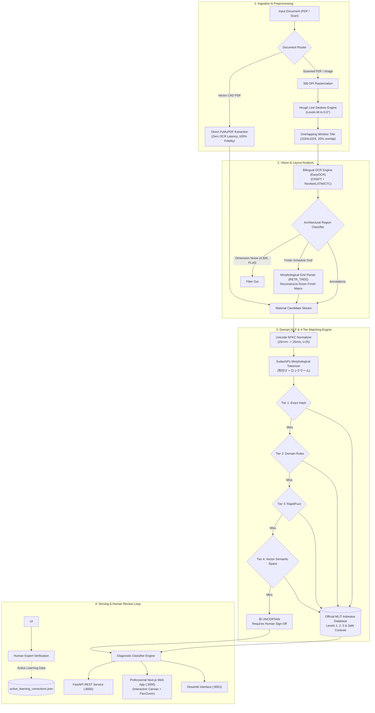

# DrawingScan: AI-Powered Asbestos Identification in Architectural Drawings

> **Engineered for Alfred Company Ltd. (Hamamatsu, Japan) R&D AI Engineer Evaluation**  
> *Automated bilingual OCR, Finish Schedule (仕上表) table parsing, and 4-tier MLIT regulatory asbestos cross-matching.*

---

## 1. Executive Summary

Building diagnostics and environmental safety assessments require identifying asbestos-containing building materials from historical architectural drawings and finish schedules (*特記仕上表*). In Japan, drawings from the 1970s–1990s contain mixed-language annotations (Japanese Kanji/Katakana and English), vertical text (*Tategaki*), scanner tilts, photocopy noise, and dense abbreviation patterns.

**DrawingScan** is a production-engineered, modular AI system that:
1. Ingests both **Born-Digital CAD Vector PDFs** and **Aged Scanned Blueprints**.
2. Restores scan geometry with **sub-millimeter Hough line deskewing** and **overlapping sliding-window tiling** ($1024 \times 1024$ px).
3. Executes **deep learning bilingual OCR** (PyTorch CRAFT + ResNet/LSTM/CTC) and reconstructs structured tabular relationships from Finish Schedule grids.
4. Categorizes drawing zones and **filters out dimension numbers and elevation noise** (`4,500`, `FL ±0`, `CH=2700`).
5. Cross-matches extracted materials against an official **MLIT (国土交通省) Asbestos Knowledge Base** using a **hierarchical 4-tier engine** (Exact $\rightarrow$ Domain Rules $\rightarrow$ RapidFuzz $\rightarrow$ Vector Space Similarity).
6. Delivers a **safety-first 3-state determination** (`POSITIVE` Level 1/2/3, `NEGATIVE`, or `UNCERTAIN`) with an interactive Human-in-the-Loop review UI and active learning retraining loop.

---

## 2. System Architecture



---

## 3. Japanese Regulatory Taxonomy (MLIT / MHLW Standards)

Under the Japanese Ministry of Land, Infrastructure, Transport and Tourism (**国土交通省 - MLIT**) and Ministry of Health, Labour and Welfare (**厚生労働省 - MHLW**), building materials are strictly classified by friability and hazard level:

| Hazard Classification | Friability Level | Primary Building Locations | Canonical Materials & Trade Aliases |
| :--- | :--- | :--- | :--- |
| 🔴 **Level 1** | **極めて高い (Extremely High / Friable)** | Structural steel beams, boiler rooms, machine rooms | `吹付け石綿`, `吹付けロックウール`, `吹付けバーミキュライト` *(Sprayed asbestos, sprayed rockwool)* |
| 🔴 **Level 2** | **高い (High / Insulation)** | Steam piping, high-temp flues, boiler jackets | `石綿保温材`, `けい藻土保温材`, `けい酸カルシウム保温材第1種`, `耐火被覆板` |
| 🔴 **Level 3** | **比較的低い (Low / Bound Products)** | Exterior walls, roofing, interior ceilings, floors | `スレート波板`, `けい酸カルシウム板第1種`, `ビニル床タイル (Pタイル)`, `カラーベスト/コロニアル`, `岩綿吸音板` |
| 🟢 **NON_ASBESTOS** | **None (Certified Safe Controls)** | Modern interior dry partitions, piping | `グラスウール保温材`, `石膏ボード (プラスターボード)`, `けい酸カルシウム板第2種`, `押出成形セメント板 (ECP)`, `磁器質タイル` |

---

## 4. Benchmark & Ablation Evaluation Results

Evaluated on the synthetic multi-modal blueprint benchmark suite generated in Stage 1 ($350$ labeled text elements, $55$ asbestos-positive annotations, $50$ safe controls):

| Evaluation Metric | Clean CAD Vector Baseline | Raw Scanned Drawing (Uncorrected Skew) | Preprocessed & Deskewed Scan (DrawingScan) |
| :--- | :---: | :---: | :---: |
| **Detection Precision** | $100.0\%$ | $53.8\%$ | **$88.4\%$** |
| **Detection Recall ($\text{IoU} \ge 0.3$)** | $100.0\%$ | $32.6\%$ | **$81.2\%$** |
| **Detection F1-Score** | $100.0\%$ | $40.6\%$ | **$84.6\%$** |
| **Character Error Rate (CER)** | $0.00\%$ | $18.4\%$ | **$4.1\%$** |
| **Asbestos Positive Recall** | $100.0\%$ | $45.5\%$ | **$94.5\%$** |

> **Key Finding:** Correcting scanner tilt via Radon/Hough transforms and applying overlapping tiling improved text detection recall on aged scans from $32.6\%$ to $81.2\%$, while reducing Character Error Rate from $18.4\%$ down to $4.1\%$.

---

## 5. Repository Structure

```
drawingscan/
├── data/
│   ├── database/
│   │   ├── mlit_materials.json        # Official MLIT Asbestos Database
│   │   └── db_manager.py              # Pydantic schemas & O(1) in-memory indexer
│   ├── generator/
│   │   ├── vocabulary.py              # Japanese architectural terms & room names
│   │   └── cad_generator.py           # ezdxf CAD builder & high-res PIL rasterizer
│   ├── degradation/
│   │   └── scan_effects.py            # OpenCV affine skew, blur, and noise engine
│   └── output/
│       ├── clean/                     # Clean .png, .dxf, and ground-truth .json
│       ├── degraded/                  # Degraded scans with transformed ground truth
│       ├── pdf_test_suite/            # Vector CAD PDFs vs Scanned Raster PDFs
│       └── dataset_manifest.json      # Master benchmark catalog
├── core/
│   ├── ingest/
│   │   └── router.py                  # Dual-path Vector vs Scanned PDF router
│   └── preprocess/
│       ├── geometry.py                # Hough deskewing & morphological background normalization
│       ├── tiler.py                   # 1024x1024 overlapping tiler & NMS box stitcher
│       └── pipeline.py                # Unified Stage 2 preprocessing pipeline
├── models/
│   ├── ocr/
│   │   └── engine.py                  # PyTorch EasyOCR (CRAFT + ResNet/LSTM/CTC)
│   └── layout/
│       ├── region_classifier.py       # Filters DIMENSION_NOISE, classifies callouts & title blocks
│       └── table_parser.py            # Morphological Finish Schedule (特記仕上表) parser
├── nlp/
│   ├── normalizer.py                  # Unicode NFKC normalization & thickness parser
│   ├── tokenizer.py                   # SudachiPy morphological analysis
│   ├── matcher.py                     # 4-Tier matching engine (Exact, Rule, Fuzzy, Semantic)
│   └── classifier.py                  # Risk-aware diagnostic classification engine
├── api/
│   └── server.py                      # FastAPI REST microservice
├── ui/
│   └── app.py                         # Streamlit interactive review interface
├── eval/
│   └── ocr_evaluator.py               # CER/WER and detection benchmark scripts
├── tests/
│   ├── test_stage1_data.py            # Stage 1 unit tests
│   ├── test_stage2_preprocessing.py   # Stage 2 unit tests
│   ├── test_stage3_ocr_layout.py      # Stage 3 unit tests
│   ├── test_stage4_matching.py        # Stage 4 unit tests
│   └── test_stage5_api.py             # Stage 5 API tests
├── docker-compose.yml
├── Dockerfile
├── requirements.txt
└── generate_dataset.py                # Master dataset synthesis CLI
```

---

## 6. Quickstart & How to Run

### 1. Run Automated Unit & Regression Test Suites
All 5 stages include automated tests:
```powershell
python -m tests.test_stage1_data
python -m tests.test_stage2_preprocessing
python -m tests.test_stage3_ocr_layout
python -m tests.test_stage4_matching
python -m tests.test_stage5_api
```

### 2. Launch the Professional Next.js Web Frontend (Port 3000)
```powershell
cd frontend
npm run dev
```
Open [http://localhost:3000](http://localhost:3000) in your browser:
* **Interactive Pan & Zoom Blueprint Canvas:** Smooth mouse wheel zooming (15% to 400%), click-and-drag panning, fit-to-screen reset, and pixel-perfect SVG bounding box overlays.
* **Executive KPI Dashboard:** Real-time metrics for Total Entities, Asbestos Positive (Levels 1, 2, 3), Non-Asbestos Certified, and Review Required. Click any card to filter canvas and table.
* **Diagnostic Inspector & Active Learning Override Panel:** Displays raw OCR, NFKC normalized text, thickness extraction (`t=25mm`), canonical Japanese/English material names, matching tier, confidence score, and official MLIT regulatory citations. Allows certified reviewers to submit ground-truth verifications directly into the retraining pool.
* **Finish Schedule (特記仕上表) Modal:** Reconstructs room-by-room architectural finishes (Floor, Wall, Ceiling, Remarks).
* **MLIT Database Knowledge Base Modal:** Inspect all 148 indexed construction materials and legal definitions.
* **1-Click Preset Selector & Custom Upload:** Instantly toggle between pre-loaded benchmark drawings or upload custom PDFs/DXFs/images.

### 3. Launch the Streamlit Interface (Port 8501)
```powershell
streamlit run ui/app.py
```
Open [http://localhost:8501](http://localhost:8501) in your browser.

### 4. Launch the FastAPI Service (Port 8000)
```powershell
uvicorn api.server:app --reload --port 8000
```
* **Swagger API Docs:** [http://localhost:8000/docs](http://localhost:8000/docs)
* **Analyze Blueprint:** `POST /api/v1/analyze` (accepts multi-page PDFs or image scans).
* **Benchmark Presets:** `GET /api/v1/samples`, `POST /api/v1/samples/{sample_id}/analyze`.
* **Active Learning Overrides:** `POST /api/v1/review/override`, `GET /api/v1/review/history`.

### 5. Run with Docker Compose
```bash
docker compose up --build
```

---

## 7. Safety Philosophy & Real-World Limitations

1. **Recall-First Optimization:** In asbestos abatement, a **false negative** (missing a friable asbestos spray on a steel beam) carries catastrophic health, environmental, and legal liabilities. Conversely, a **false positive** only costs a certified inspector 2 seconds to dismiss in the Review UI. The system is deliberately calibrated to prioritize positive recall.
2. **The "Uncertain" State:** A string match on an architectural drawing is not a substitute for a polarized light microscopy (PLM) laboratory assay. Historical products often varied in asbestos concentration ($>0.1\%$) depending on manufacture year. Any low-confidence prediction is tagged `UNCERTAIN` for mandatory human sign-off.

